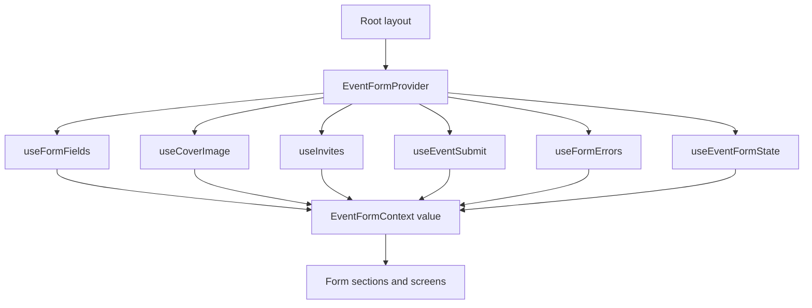

# Tech stack

How this app is built: the libraries, where each kind of code lives, and how one React Context holds the create-event form.

[Back to the README](../README.md)

## Libraries

| Piece | Role |
| --- | --- |
| Expo SDK 58 | React Native app shell, dev server, and native modules |
| React 19 and React Native | UI |
| TypeScript | Types for form values, errors, and the submitted payload |
| Expo Router | File routes in `src/app/`. `/` is the form. `/event` is the saved summary |
| React Context | One provider for form values and the actions that change them |
| `expo-image-picker` | Cover image from the photo library |
| `expo-file-system` | File size when the picker does not report one |
| `tsx` | Runs the validation tests with `npm test` |

There is no form library and no global store. Validation is a set of pure functions. The context calls those functions. It does not contain the rules.

Nothing is sent to a server. A successful submit stores the payload in context and shows it on the event screen.

## Folder structure

Atomic design. A route file only renders a screen. A screen only wires navigation. Visual pieces do not validate. Validation does not import React.

```
src/
  app/                  screens registered with Expo Router
  screens/              route containers
  components/
    atoms/              text, buttons, text input, field error
    molecules/          label, hint, banner, privacy card, rows
    organisms/          one form section each, plus the form and success state
    templates/          header, scrolling body, footer
  state/                form values, image issue, invites, and submit status
  hooks/                field, cover image, invite, error, and submit actions
  context/              provider that combines the state and hooks
  styles/               StyleSheet for every screen and component
  validation/           field switch and checkers
    constants/          punctuation, image types, email pattern, text limits
  services/             photo library picker
  data/                 mock communities and saved contacts
  types/                form values, privacy, and payload
  theme/                colors and spacing
  utils/                file size and success copy
```

| Folder | Owns | Does not own |
| --- | --- | --- |
| `app/` | Route files: `_layout.tsx`, `index.tsx`, `event.tsx` | Form logic |
| `screens/` | Navigation, such as pushing `/event` | Layout and fields |
| `components/` | What the user sees, read through `useEventForm` | Rules and storage |
| `state/` | `useState` for the draft, status, and payload | When a field is invalid |
| `hooks/` | Actions: type, pick a photo, invite, submit, reset | The provider |
| `context/` | The public form API | Field components |
| `styles/` | One `StyleSheet` per screen or component | Values |
| `validation/` | Pure checks and the payload builder | React |
| `services/` | Talking to the photo library | Form state |
| `data/` | Mock communities and saved contacts | User input |
| `types/` | `EventFormValues`, `EventPayload`, `ImageIssue` | Behavior |
| `theme/` | Colors and spacing | Components |
| `utils/` | File size text and success copy | Validation |

`app/index.tsx` renders `CreateEventScreen`. That screen renders `CreateEventTemplate` and passes `router.push("/event")` as **View event**. `app/event.tsx` reads the same context, so the summary can show the payload saved on the form screen.

## Context API

`EventFormProvider` wraps the navigator in `src/app/_layout.tsx`. Every screen under that layout can call `useEventForm()`. A call outside the provider throws `useEventForm must be used within EventFormProvider`.

The provider does not put a giant reducer in one file. It builds one value from a state hook and five action hooks:



`useEventFormState` holds the React state. The other hooks only receive that state object and return functions. `useFormErrors` does not store errors. It derives them on each render from the current values.

### What the context exposes

`EventFormContextValue` in `src/context/types.ts` is the only shape components see.

| Field | Meaning |
| --- | --- |
| `values` | The draft: image, title, both descriptions, privacy, community ids, invites |
| `errors` | Messages that should be on screen right now |
| `imageIssue` | Permission, file type, or file size problem from the picker |
| `inviteDraft` | Text still sitting in the invite field, not yet a chip |
| `status` | `editing`, `submitting`, or `success` |
| `payload` | The event saved after a valid submit, or `null` |
| `attentionCount` | How many error messages to mention after a failed submit. `0` before the first submit |
| `failureNonce` | Increments on each failed submit so the screen can scroll to the top |
| `setTitle`, `setShortDescription`, `setFullDescription` | Replace that text field |
| `setPrivacy` | `public` or `private`. Does not clear communities or invites |
| `toggleCommunity` | Add or remove one community id |
| `pickImage`, `removeImage`, `openSettings` | Photo library, clear the cover, open system settings |
| `setInviteDraft`, `addInviteDraft`, `addSavedContact`, `removeInvite` | Invite field and chips |
| `submit` | Validate, then store the payload |
| `reset` | Drop the draft and return to `editing` |

`commitPendingInvites` stays inside the provider. Components never call it. Submit uses it so a private event still picks up an email that was typed but not added as a chip.

### Who reads it

| Component | Uses |
| --- | --- |
| `CreateEventTemplate` | `status`, `attentionCount`, `failureNonce`, `submit`, `reset` |
| `EventForm` | `values`, to show communities or invites |
| `TitleField`, `ShortDescriptionField`, `FullDescriptionField` | That field's value, error, and setter |
| `CoverImageField` | `values`, `errors`, `imageIssue`, `pickImage`, `removeImage`, `openSettings` |
| `VisibilityField` | `values`, `errors`, `setPrivacy` |
| `CommunitiesField` | `values`, `toggleCommunity` |
| `InvitesField` | Invite draft, list, and invite actions |
| `SuccessState`, `EventDetailScreen` | `payload` |

### State that is not a form field

`useEventFormState` keeps a few values beside `values`:

- `imageIssue` is separate from `values.image`. A rejected file never becomes the cover. Clearing the issue and clearing the image are both explicit.
- `inviteDraft` and `inviteDraftError` are the in-progress address. The chip list is `values.invites`.
- `submitAttempted` flips to true on **Create event**. Length and required-field messages wait for that. Permission, file type, file size, a bad invite, and a non-English character in the short description show immediately. `displayedErrors` in `src/context/displayedErrors.ts` makes that split.
- `status` and `payload` describe the last attempt. `payload` is what **View event** renders.
- `submissionId` is a ref. Reset increments it. A submit that is still in its short wait checks the id and does nothing if the user already started over.

Switching public and private only patches `privacy`. Communities and invites stay in memory, so switching back restores them. A public submit ignores invites. A private submit ignores communities. That split is in `toPayload` inside `validateEventForm`, not in the context provider.

### Submit

1. Ignore the press when `status` is already `submitting`.
2. Dismiss the keyboard and take the next submission id.
3. If privacy is private and the invite field has text, commit that text into `values.invites` first.
4. Set `submitAttempted` so field errors can appear.
5. Run `validateEventForm`. Also block when there is an image issue and no cover.
6. On failure, stay on `editing` and increment `failureNonce`.
7. On success, set `submitting`, wait briefly, then store `payload` and set `success`. If `reset` ran during the wait, the submission id no longer matches and the payload is not stored.

`reset` increments the submission id and calls `clearForm`, which restores `initialFormValues` and clears the image issue, invite draft, status, payload, and submit flag.
